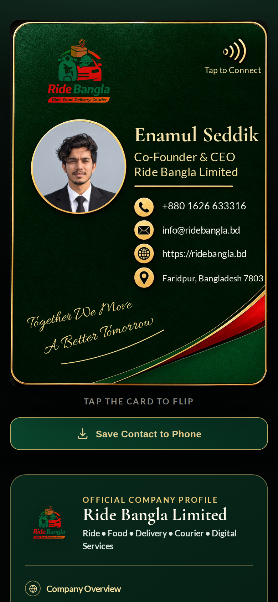
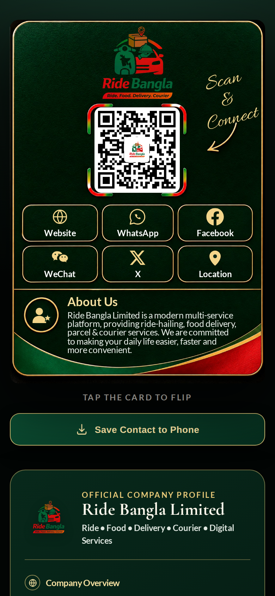
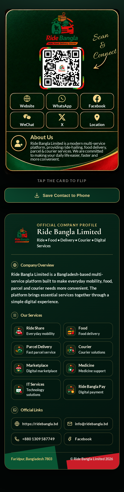
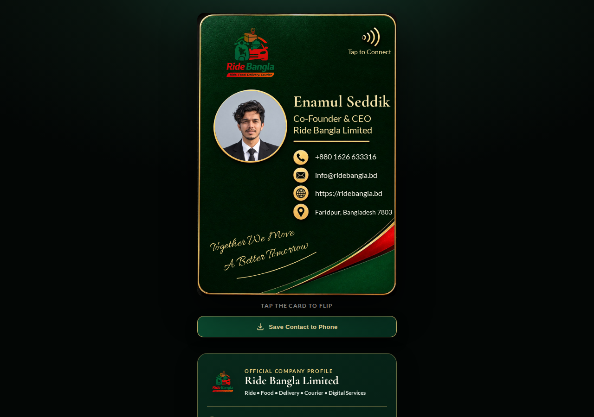

<div align="center">



# Enamul Seddik

### Co-Founder & CEO · Ride Bangla Limited

**The digital NFC visiting card of the Co-Founder & CEO of Ride Bangla Limited — tap the physical card, scan the QR, or open the link, and the card is on your phone: view it, flip it, connect, and save the contact in one tap.**

[](https://ceo.ridebangla.bd)
[](LICENSE)

[Open the live card](https://ceo.ridebangla.bd) · [Official Website](https://ridebangla.bd)

</div>

---

## About

This repository is the **digital visiting card of Enamul Seddik, Co-Founder & CEO of Ride Bangla Limited** — the web page behind his physical NFC card, live at [ceo.ridebangla.bd](https://ceo.ridebangla.bd).

The page presents the card exactly as the physical card presents him: a premium dark-green and gold card — the Ride Bangla logo sitting directly on the dark-green design — with his portrait, name, title and direct contact rows on the front, and a **“Scan & Connect”** QR side on the back. Below the card, the same page carries the official company profile: a company overview, the complete Ride Bangla service showcase, and the official links.

It is intentionally a **visiting card only** — a single self-contained page with no backend, no forms and no account system. Its design and content are **final, as confirmed by the owner**; this README documents the card as it is.

> **Together We Move — A Better Tomorrow** · Faridpur, Bangladesh 7803

---

## What the card does

**Tap, open, view, connect, save** — everything happens on the one page:

1. **Tap or open** — tapping the physical NFC card (or opening [ceo.ridebangla.bd](https://ceo.ridebangla.bd), or scanning the QR code) lands on the card. The front face greets with **“Tap to Connect”**.
2. **View** — the front face shows the portrait, name, title, company and tap-to-act contact rows. **“Tap the card to flip”**: a real CSS 3D flip turns the card over (keyboard `Enter` / `Space` works too; taps on links and buttons never flip it by accident). The card keeps its exact artwork proportion (`1051 / 1496`) at any screen size.
3. **Connect** — the back face offers six tiles: **Website**, **WhatsApp**, **Facebook**, **WeChat**, **X** and **Location**, plus a short About Us. The front face rows dial, email, open the website and open the location directly.
4. **Save** — **Save Contact to Phone** builds a standard vCard in the browser and downloads it (`Enamul-Seddik-RideBangla.vcf`), together with both card faces as images (`Enamul-Seddik-RideBangla-Card-Front.jpg` / `-Card-Back.jpg`). Everything is client-side — there is no server endpoint.
5. **Pass it on** — the QR code on the back is generated in the browser on every load and points back at the card itself (`https://ceo.ridebangla.bd/`), so anyone who scans it lands on this same card and can save the contact in turn.

### Contact actions — exactly as the card implements them

| Action | Destination |
|---|---|
| Call (personal) | +880 1626 633316 |
| Email | info@ridebangla.bd |
| Website | https://ridebangla.bd |
| Location | Faridpur, Bangladesh 7803 (Google Maps search link) |
| WhatsApp | https://wa.me/8801626633316 |
| Facebook (personal) | https://www.facebook.com/enamulseddik |
| X (personal) | https://x.com/enamulseddik |
| WeChat | Tapping the tile copies the WeChat ID `enamulseddik` and offers the `weixin://` app link |
| Company phone (company panel) | +880 1309 587749 |

### QR connect

The QR is not a stored image. On every load the page generates it with qrcode-generator 1.4.4 (cdnjs, SRI-pinned) at high error correction (`H`) and inserts it as SVG into the back face:

```js
const q = qrcode(0, 'H');
q.addData('https://ceo.ridebangla.bd/');
q.make();
```

---

## Services

The card's company panel presents the complete Ride Bangla service list — **Ride • Food • Delivery • Courier • Digital Services** — exactly as shown on the card:

| Service | As the card describes it |
|---|---|
| Ride Share | Everyday mobility |
| Food | Food delivery |
| Parcel Delivery | Fast parcel service |
| Courier | Courier solutions |
| Marketplace | Digital marketplace |
| Medicine | Medicine support |
| IT Services | Technology solutions |
| Ride Bangla Pay | Digital payment |

**Company Overview, as the card states it:** “Ride Bangla Limited is a Bangladesh-based multi-service platform built to make everyday mobility, food, parcel and courier needs more convenient. The platform brings essential services together through a simple digital experience.”

---

## Screenshots

Fresh captures of the live card at [ceo.ridebangla.bd](https://ceo.ridebangla.bd), taken for this README.

<table>
  <tr>
    <td align="center" width="50%"><br/><b>Front face — phone</b><br/><sub>Identity, portrait and tap-to-act contact rows; “Tap to Connect”.</sub></td>
    <td align="center" width="50%"><br/><b>Back face — phone</b><br/><sub>“Scan &amp; Connect” QR, six connect tiles and About Us.</sub></td>
  </tr>
  <tr>
    <td align="center" width="50%"><br/><b>Full page — phone</b><br/><sub>The card, Save Contact, and the company panel below it: overview, all 8 services and official links.</sub></td>
    <td align="center" width="50%"><br/><b>Front face — desktop</b><br/><sub>The phone-first card centred at its exact proportion on a wide screen.</sub></td>
  </tr>
</table>

The card's own artwork files also live in this repository: `card-front.jpg` and `card-back.jpg` (1051 × 1496).

---

## Tech

One self-contained page — no framework, no package manager, no build step.

| Layer | Implementation |
|---|---|
| Entry point | `index.html` — a single file holding the markup, CSS, JavaScript and inline imagery |
| Styling | Embedded CSS with custom properties and container-query scaling (`--u: calc(100cqw / 1051)`), so the card's typography scales with the card itself |
| Interactions | Vanilla JavaScript — 3D flip, QR generation, vCard + card-image downloads, WeChat ID copy with toast |
| Card faces | `card-front.jpg` / `card-back.jpg` as the face backgrounds (1051 × 1496) |
| QR | qrcode-generator 1.4.4 (cdnjs, SRI SHA-384 pinned) |
| Face export | html2canvas 1.4.1 (cdnjs, SRI SHA-384 pinned), with a fallback to the stored face images |
| Fonts | Google Fonts — Allura, Cormorant Garamond (600/700), Lato (400/700) |
| PWA | `manifest.json` — standalone, portrait, theme `#030605`, icons 192/512 + maskable 512 + apple-touch 180 |
| Hosting | Vercel static (`vercel.json` — clean URLs, rewrite to `index.html`, security headers) |

**Design language — the card's own:** a deep-green radial ground (`#173b2d` → `#09130e` → `#030605`), emerald surfaces (`#0b4a30` / `#0b5a37`), gold metallic accents (`--gold: #e7c978`, `--gold-light: #f5dfa0`), Bangladesh red (`--red: #d51d2a`), rounded gold card borders, Cormorant Garamond serif display type and Allura script for the “Scan & Connect” treatment. The logo sits directly on the dark green — exactly as on the card itself.

---

## Security

`vercel.json` serves the page with a Content-Security-Policy, Strict-Transport-Security (preload), `X-Frame-Options: SAMEORIGIN`, `X-Content-Type-Options: nosniff`, `Referrer-Policy: strict-origin-when-cross-origin`, and a Permissions-Policy with camera, microphone and geolocation off. Both third-party scripts are SRI-pinned, so a tampered CDN file cannot execute.

Found a vulnerability? Please report it privately — see **[SECURITY.md](SECURITY.md)**. Do not open a public issue for a security problem.

---

## The Ride Bangla ecosystem

Every Ride Bangla service, with working links:

| Service | Link | What it is |
|---|---|---|
| **Main Website** | [ridebangla.bd](https://ridebangla.bd) | The official public face of Ride Bangla |
| **AI Agent** | [ai.ridebangla.bd](https://ai.ridebangla.bd) | AI customer-service agent platform for businesses |
| **Studio** | [studio.ridebangla.bd](https://studio.ridebangla.bd) | AI-powered ad, image and video generation |
| **Tools** | [tools.ridebangla.bd](https://tools.ridebangla.bd) | Free online tools for everyday tasks |
| **IT Team** | [it.ridebangla.bd](https://it.ridebangla.bd) | App, website, graphics and digital development services |
| **Customer** | [customer.ridebangla.bd](https://customer.ridebangla.bd) | Customer platform for Ride Bangla services |
| **Partner** | [partner.ridebangla.bd](https://partner.ridebangla.bd) | Business and merchant platform for partners |
| **Rider** | [rider.ridebangla.bd](https://rider.ridebangla.bd) | Operational platform for registered riders |
| **Agent** | [agent.ridebangla.bd](https://agent.ridebangla.bd) | Official platform for the agent network |

---

## Contact & community

- **The card:** [ceo.ridebangla.bd](https://ceo.ridebangla.bd)
- **Email:** [info@ridebangla.bd](mailto:info@ridebangla.bd)
- **Company phone / WhatsApp:** +880 1309 587749
- **Location:** Faridpur, Bangladesh 7803

**Follow Ride Bangla everywhere**

<a href="https://www.facebook.com/ridebangla"></a>&nbsp;&nbsp;<a href="https://x.com/ridebangla"></a>&nbsp;&nbsp;<a href="https://www.instagram.com/ride.bangla_"></a>&nbsp;&nbsp;<a href="https://www.threads.net/@ride.bangla_"></a>&nbsp;&nbsp;<a href="https://www.tiktok.com/@ridebangla0"></a>&nbsp;&nbsp;<a href="https://www.youtube.com/@ridebangla-0"></a>

[Facebook](https://www.facebook.com/ridebangla) · [X](https://x.com/ridebangla) · [Instagram](https://www.instagram.com/ride.bangla_) · [Threads](https://www.threads.net/@ride.bangla_) · [TikTok](https://www.tiktok.com/@ridebangla0) · [YouTube](https://www.youtube.com/@ridebangla-0)

**Community:** join the one and only official Ride Bangla community group — [Ride Bangla Community on Facebook](https://www.facebook.com/share/g/1CfmiTzv1D/).

---

## License

Proprietary — © 2026 Ride Bangla Limited. All rights reserved.

This software, including its source code, designs, documentation and assets, is the exclusive property of Ride Bangla Limited and may not be copied, reproduced, modified, distributed or otherwise used without prior written permission, except where a separate written agreement expressly permits it. Third-party components remain under their own open-source licenses. See **[LICENSE](LICENSE)** for the full text.

---

<div align="center">

**Ride Bangla Limited** · Faridpur, Bangladesh

*One digital card. One professional identity.*

</div>
