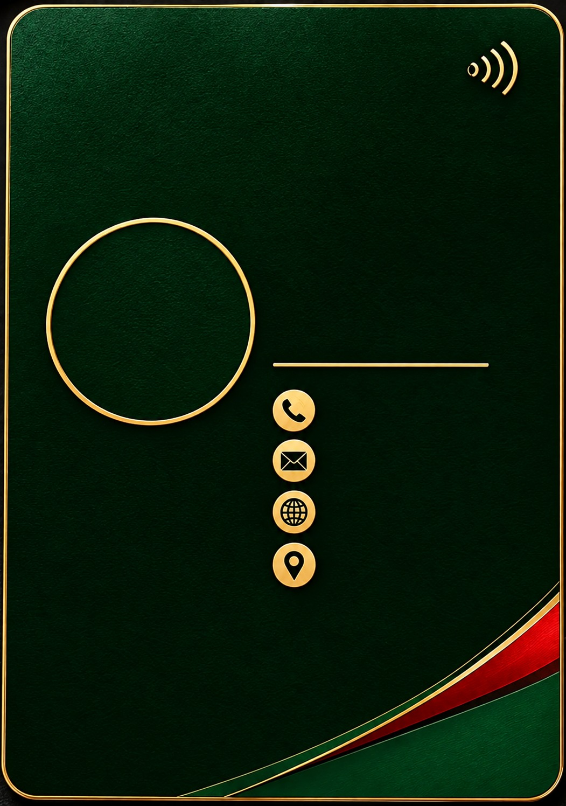
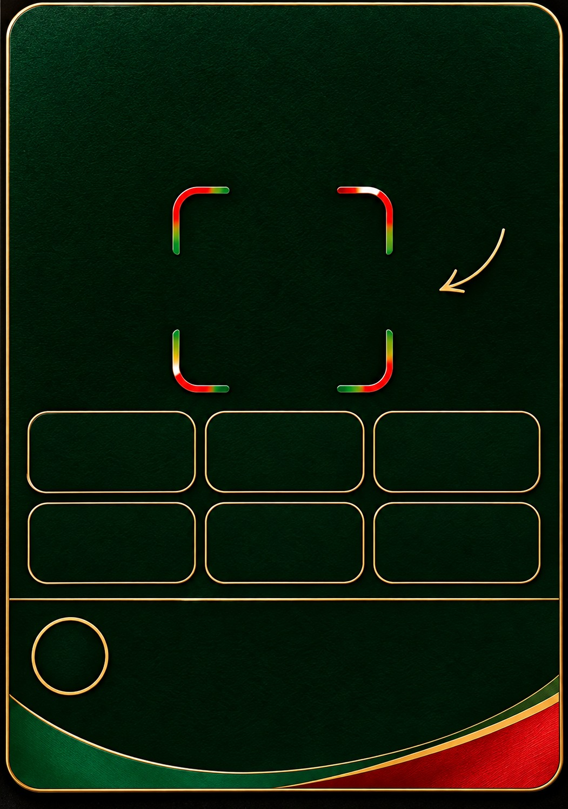

<p align="center">
  
</p>

<h1 align="center">🇧🇩 Ride Bangla — CEO Digital Visiting Card</h1>

<h3 align="center">
  Enamul Seddik · Co-Founder &amp; CEO · Ride Bangla Limited
</h3>

<p align="center">
  <strong>Production • Static HTML / CSS / JavaScript • Vercel • No Build Step</strong>
</p>

<p align="center">
  NFC Card • QR Connect • Save Contact • vCard • 3D Card Flip • Service Showcase • Faridpur, Bangladesh
</p>

<p align="center">
  
  
  
  
  
</p>

<p align="center">
  <a href="https://ceo.ridebangla.bd"><strong>Live Card</strong></a>
  ·
  <a href="https://ridebangla.bd">Official Website</a>
</p>

---

## 📌 Project Status

| Area | Status |
|---|---|
| Production | ✅ Live at [ceo.ridebangla.bd](https://ceo.ridebangla.bd) |
| Card design & content | 🔒 **FINAL — frozen** by the owner's decision (2026-10-20). Only bug-class fixes (spelling, names/titles, service list) may ever be made, and only on the owner's order |
| Functional re-audit (2026-10-22) | ✅ Complete — every contact action, link and asset verified end to end; live page byte-identical to the FINAL build. An independent second check then found **two accessibility defects** the first pass missed — the card flip was mouse/touch-only (no keyboard operation), and four front-face tap targets were unnamed duplicate links. Both were fixed the same day with attribute/handler-only changes; the card's design and rendering are unchanged |
| Repository cleanup (2026-10-22) | ✅ Complete — one proven orphan asset removed (368,570 bytes); repository slimmed from 30 → 29 files; the rendered card did not change by a single byte |
| This README | ✅ Rewritten 2026-10-22 to the project's true current state |

### What remains

- **Owner decision — retained original artwork files (1,514,963 bytes).** The page renders the CEO portrait and all 8 service icons from inline data URIs, so it never downloads `photo.png` or `assets/services/*.svg`. Those files are the stored originals and are kept for now; removing them is a one-commit change whenever the owner decides. Details in [Repository Notes](#-repository-notes).
- **Owner decision — Save Contact button font.** The button's CSS declares `"Plus Jakarta Sans", Arial, sans-serif`, but Plus Jakarta Sans is not among the fonts the page loads, so the button renders in Arial. Loading the font would change the FINAL card's typography, so this stays as-is unless the owner orders the change.
- Nothing else is outstanding. There is deliberately **no** help center or AI agent on this card — it is a personal visiting card, by the owner's ruling.

---

## 🖼 Visual Preview

The card's own artwork, straight from this repository — the real card faces are the presentation.

<table>
<tr>
<td align="center" width="50%">

**Front**

<br>



</td>
<td align="center" width="50%">

**Back**

<br>



</td>
</tr>
</table>

<table>
<tr>
<td align="center" width="50%">

**Ride Bangla Logo** (`logo.png`, 500 × 500)

<br>


</td>
<td align="center" width="50%">

**CEO Portrait** (`photo.png`, 640 × 640)

<br>


</td>
</tr>
</table>

---

## 📇 About This Project

This repository is the **digital visiting card of Enamul Seddik, Co-Founder & CEO of Ride Bangla Limited** — the web experience behind the physical NFC card.

A visitor who taps the NFC card (or opens the link, or scans the QR code) lands on a single page that behaves like the physical card: a premium dark-green and gold card that **flips in 3D**, with working contact actions on both faces, a company overview, the Ride Bangla service showcase, and a one-tap **Save Contact** that downloads a standard vCard plus both card faces as images.

It is intentionally a **visiting card only** — no help center, no AI agent, no forms, no backend.

---

## 🎴 The Card Experience

### Front face
Identity and direct contact: name, title, company, portrait, and tap-to-act rows for phone, email, website and location.

### Back face
Connection: a dynamically generated **QR code**, six social/contact tiles (website, WhatsApp, Facebook, WeChat, X and location) and a short About blurb. The company overview, the 8-service showcase, the official links and the **Save Contact** button are not on the card — they sit below it, in the company panel.

### 3D flip
A real CSS 3D rotation — not an image swap:

```css
.inner {
  transform-style: preserve-3d;
  transition: transform .82s cubic-bezier(.2,.75,.18,1);
}
.inner.flipped { transform: rotateY(180deg); }
.front { background-image: url(card-front.jpg); }
.back  { background-image: url(card-back.jpg); transform: rotateY(180deg); }
```

Taps on links and buttons never trigger an accidental flip. The card keeps the artwork's exact proportion (`aspect-ratio: 1051/1496`) and scales its typography with a container-query unit (`--u: calc(100cqw/1051)`), so it stays correct on any phone screen. `Enter` / `Space` flip the card from the keyboard.

---

## 🔗 Contact Actions

Every value below is read from the live card source.

| Action | Value |
|---|---|
| Call (personal) | `+880 1626 633316` |
| Call (company) | `+880 1309 587749` |
| Email | `info@ridebangla.bd` |
| Website | `https://ridebangla.bd` |
| WhatsApp | `https://wa.me/8801626633316` |
| Facebook | `https://www.facebook.com/enamulseddik` |
| X | `https://x.com/enamulseddik` |
| WeChat | tap copies the ID `enamulseddik` and offers the `weixin://` app link |
| Location | Faridpur, Bangladesh 7803 (Google Maps search link) |

---

## 📲 QR Connect

The QR code is generated in the browser on every load (qrcode-generator 1.4.4 from cdnjs, SRI-pinned) and points at the card itself:

```js
const q = qrcode(0, 'H');
q.addData('https://ceo.ridebangla.bd/');
q.make();
```

High error correction (`H`); the generated SVG is inserted into the back face's QR container. No QR artwork needs to be maintained by hand.

---

## 💾 Save Contact

One tap builds a **vCard 3.0** in the browser and downloads `Enamul-Seddik-RideBangla.vcf`:

- Enamul Seddik — Ride Bangla Limited — Co-Founder & CEO
- Phone `+8801626633316` · Email `info@ridebangla.bd` · Website `ridebangla.bd`
- Address: Faridpur 7803, Bangladesh

The same action renders both card faces with html2canvas 1.4.1 (cdnjs, SRI-pinned) and downloads `Enamul-Seddik-RideBangla-Card-Front.jpg` / `-Card-Back.jpg`; if rendering is unavailable it falls back to downloading the stored `card-front.jpg` / `card-back.jpg`. Everything is client-side — there is no server endpoint.

---

## 🧰 Services on the Card

The back face presents 8 Ride Bangla services, each with its own artwork (rendered on the page from inline SVG data URIs):

| Service | Description |
|---|---|
| Ride Share | Everyday mobility |
| Food | Food delivery |
| Parcel Delivery | Fast parcel service |
| Courier | Courier solutions |
| Marketplace | Digital marketplace |
| Medicine | Medicine support |
| IT Services | Technology solutions |
| Ride Bangla Pay | Digital payment |

Company positioning on the card: **Ride • Food • Delivery • Courier • Digital Services**.

---

## 🏗 How It Is Built

One self-contained page. No framework, no package manager, no build step.

| Layer | Implementation |
|---|---|
| Entry point | `index.html` (single file, 1,333,493 bytes — markup, CSS, JS and inline imagery) |
| Styling | Embedded CSS, CSS custom properties, container-query scaling |
| Interactions | Vanilla JavaScript (one inline script) |
| Card faces | `card-front.jpg` / `card-back.jpg`, 1051 × 1496 |
| QR | qrcode-generator 1.4.4 (cdnjs, SRI SHA-384 pinned) |
| Face export | html2canvas 1.4.1 (cdnjs, SRI SHA-384 pinned) |
| Fonts | Google Fonts — Allura, Cormorant Garamond (600/700), Lato (400/700) |
| PWA | `manifest.json` — standalone, theme `#030605`, icons 192/512 + maskable 512 + apple-touch 180 |
| Hosting | Vercel static (`vercel.json`) |

### Design language
Deep green / emerald surfaces, gold metallic accents (`--gold: #e7c978`, `--gold-light: #f5dfa0`), Bangladesh red (`--red: #d51d2a`), rounded gold card borders, premium serif display type (Cormorant Garamond) with Allura script for the connection treatment.

---

## 🔒 Security Headers

`vercel.json` serves the page with: Content-Security-Policy, Strict-Transport-Security (preload), X-Frame-Options `SAMEORIGIN`, X-Content-Type-Options `nosniff`, Referrer-Policy `strict-origin-when-cross-origin`, and Permissions-Policy (camera / microphone / geolocation off). Both third-party scripts are SRI-pinned, so a tampered CDN file cannot execute.

---

## 📁 Repository Structure

```text
CEO-NFC-Visiting-Card-/
│
├── index.html                  ← the entire card (page + CSS + JS)
├── vercel.json                   ← hosting: clean URLs, rewrite, security headers
├── manifest.json               ← PWA manifest
├── robots.txt                  ← points to sitemap.xml
├── sitemap.xml                 ← the card URL
│
├── logo.png                    ← Ride Bangla logo (500 × 500) — used by the page
├── photo.png                   ← CEO portrait original (640 × 640) — see Notes
├── card-front.jpg              ← front card artwork (1051 × 1496)
├── card-back.jpg               ← back card artwork (1051 × 1496)
│
├── favicon.ico
├── icon-192.png
├── icon-512.png
├── icon-maskable-512.png
├── apple-touch-icon.png
│
├── assets/
│   └── services/               ← service artwork originals — see Notes
│       ├── courier.svg
│       ├── food.svg
│       ├── it-services.svg
│       ├── marketplace.svg
│       ├── medicine.svg
│       ├── parcel-delivery.svg
│       ├── ride-bangla-pay.svg
│       └── ride-share.svg
│
├── README.md
├── LICENSE                     ← proprietary, © Ride Bangla Limited
├── CLIENT-LICENSE-TEMPLATE.txt ← licence template for client handovers
├── SECURITY.md
├── CODE_OF_CONDUCT.md
├── CONTRIBUTING.md
└── .gitignore
```

---

## 🗒 Repository Notes

**How the page uses images.** The rendered page loads only: `logo.png`, `card-front.jpg`, `card-back.jpg`, the favicon/manifest icons and `manifest.json`. The CEO portrait and the 8 service icons are embedded in `index.html` as data URIs, so the page works even though it never requests the files below.

**Retained originals (owner decision pending).** `photo.png` (510,190 bytes) and `assets/services/*.svg` (1,004,773 bytes together) are the stored original artwork for the portrait and service marks. A full reference scan on 2026-10-22 proved the page never references them; they are retained until the owner decides on removal.

**Removed in cleanup (2026-10-22).** `assets/logo-ride-bangla-transparent.png` (368,570 bytes) — proven zero references anywhere in the repository (page, manifest, config, meta/OG/JSON-LD, README) and zero hits in GitHub code search; removed in a single commit. The rendered card is byte-identical before and after (page MD5 `f298284648fe26c6327ebc4d85c8a1bf`).

---

## 🚀 Deployment

Static hosting on **Vercel**. `vercel.json` enables clean URLs and declares a catch-all rewrite to `index.html`, with the security headers above. (In practice the card is a single page at `/`; unknown paths still return 404.) There is no build command and no environment configuration — pushing to `main` deploys the card.

---

## ⛔ Working Rules for This Repository

- The card is **FINAL**. Its design, logo, layout and wording do not change — ever — unless the owner personally orders a specific change.
- Permitted without a design order: bug-class fixes only — a spelling mistake, a wrong name/title, a broken link, a missing or misnamed canonical service.
- This README is the project's living record: every work session updates it to the project's true state in the same session.
- No help center, no AI agent, no analytics or extra features are added to the card. It is a visiting card.

---

## 📄 License

Proprietary — © Ride Bangla Limited, all rights reserved. See [`LICENSE`](./LICENSE). [`CLIENT-LICENSE-TEMPLATE.txt`](./CLIENT-LICENSE-TEMPLATE.txt) is the licence template used when Ride Bangla hands over a client build. Security reports: see [`SECURITY.md`](./SECURITY.md).

---

<p align="center">
  <strong>Ride Bangla</strong><br/>
  One digital card. One professional identity.<br/>
  <code>Ride Bangla Limited · Faridpur, Bangladesh</code>
</p>

<p align="center">
  
</p>
